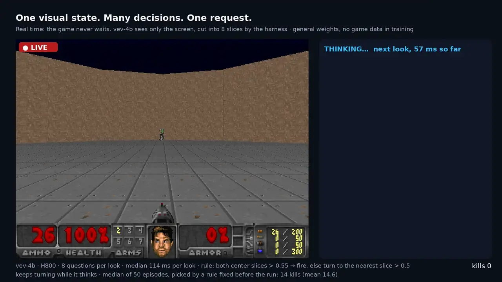
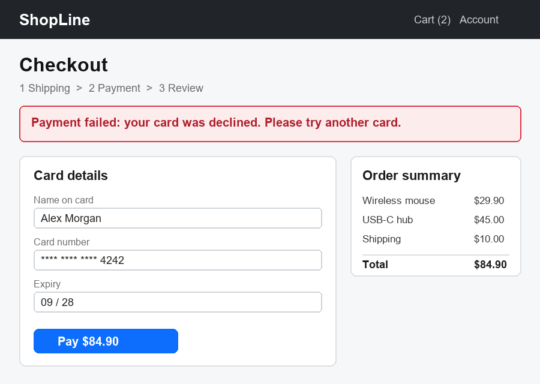

# Vev

[](README.md) [](README_zh.md) [](https://huggingface.co/collections/CountingSheep/vev) [](https://huggingface.co/spaces/CountingSheep/vev)

**Jev-like decision models that can also see images.**



The first-generation vev-4b playing Doom in real time. For every frame, a small harness cuts the screen into 8 vertical slices and
sends one request with a yes/no question per slice ("does this slice show a monster?"); a fixed rule turns the answers
into turning and firing. The game does not pause for the model.

The input is a piece of text, a JSON record or a screenshot, plus a few yes/no, multiple-choice or graded questions;
the output is a probability for each option. The model only scores the given options and does not generate text. One
image question takes about 100–120 ms on a single GPU ([speed](#speed)). The weights are open and can be run locally.

- **Jev API compatible.** [Jev](https://typesafe.ai/blog/introducing-system-one-models-and-jev) is TypeSafe's hosted
  decision model. Vev implements the same `/v1/systemone` request format; code written with TypeSafe's SDK only needs a
  different base URL.
- **Image input.** Screenshots and photos can be sent in the request together with text.
- **English and Chinese.** Fine-tuned from Qwen3.5.



```python
# client and checkout_png are created as shown in Get started
resp = client.system_one(
    state={"screen": {"image": {"url": checkout_png}}},
    questions={
        "error": Noul(instructions="Does the screen show an error message?"),
        "step": Choice(instructions="Which checkout step is the user on?",
                       criteria={"shipping": None, "payment": None, "review": None}),
        "next": Choice(instructions="What should the user do next?",
                       criteria={"retry": "Try another card", "wait": "Wait for the order to ship",
                                 "nothing": "Nothing, the order went through"}),
    },
)
# vev-4b-v2:  error 0.996
#                step  {"shipping": 0.002, "payment": 0.965, "review": 0.033}
#                next  {"retry": 0.996, "wait": 0.002, "nothing": 0.003}
```

The current model is `vev-4b-v2`, the second generation of `vev-4b`; `vev-9b` has not been retrained. This is a
research preview, and the weights are licensed under CC BY-NC 4.0. On one of the four text sets, Jev is still clearly
more accurate (see [Text](#text)).

## Get started

Requirements: Python 3.11 or newer, an NVIDIA GPU and a CUDA build of PyTorch. On Windows, pip installs a CPU-only
PyTorch by default, so install `torch` and `torchvision` from [pytorch.org](https://pytorch.org/get-started/locally/)
first.

```bash
pip install git+https://github.com/Xiaooolong/vev
vev serve --model CountingSheep/vev-4b-v2          # downloads the weights on first start, listens on 127.0.0.1:8009
```

On first start the server warms up its GPU kernels, which takes about two minutes with an empty Triton cache.

Requests can then be sent with TypeSafe's Python SDK (`pip install typesafe-sdk`):

```python
from typesafe_sdk import Choice, Noul, TypeSafeClient

client = TypeSafeClient(api_key="local", base_url="http://127.0.0.1:8009")
resp = client.system_one(
    state="Order #4411 still shows 'label created' after 9 days. I need it before Friday.",
    questions={
        "urgent": Noul(instructions="Is the customer asking for something time-sensitive?"),
        "team": Choice(instructions="Which team should handle this?",
                       criteria={"shipping": "Delivery and tracking", "billing": "Charges and refunds"}),
    },
)
print(resp.answers["urgent"].noul)          # probability of "yes": 0.97 with vev-4b-v2
print(resp.answers["team"].probabilities)   # {"shipping": 0.97, "billing": 0.03}
```

`Noul` is the API's type name for a yes/no question. The state can be a string or any JSON object; an image is
written as `{"image": {"url": "data:image/png;base64,..."}}` and can appear anywhere inside it:

```python
import base64

checkout_png = "data:image/png;base64," + base64.b64encode(open("docs/checkout.png", "rb").read()).decode()
```

### Other ways to run it

- Docker: `docker build -t vev .`, then
  `docker run --gpus all -p 8009:8009 -v ~/.cache/huggingface:/root/.cache/huggingface vev --model CountingSheep/vev-4b-v2`.
- The pinned environment and start script used for the Decision Index runs are in [docs/serving.md](docs/serving.md).
- Without the HTTP server, calling the model from Python:

  ```python
  from vev.model import CheckpointEngine

  engine = CheckpointEngine("CountingSheep/vev-4b-v2")
  result = engine.run({"ticket": "My kettle never arrived."},
                      {"refund": {"type": "noul", "instructions": "Is the customer asking for a refund?"}})
  print(result.answers["refund"]["noul"])
  ```

- In another inference engine: [spec/systemone-api.md](spec/systemone-api.md), section 10, gives the prompt
  template and which token probabilities to read; [How it works](#how-it-works) describes the reading layout of
  `vev-4b-v2`.

### Speed

On the public items of the Decision Index vision suite, timed the way that board times submissions (one request at a
time with one question, end to end including encoding the images on the client, images up to 1.6 MP):

| GPU | Items | median | mean | p80 |
|---|---|---|---|---|
| H800 | all 12,210 | 101 ms | 151 ms | 225 ms |
| RTX PRO 6000 Blackwell | 1,294, weighted to the whole suite | 120 ms | 182 ms | 283 ms |

All questions of a request run as one batch. A `vev serve` process handles one request at a time; for more
throughput, start one process per GPU. Details: [docs/serving.md](docs/serving.md#latency).

## Results

Accuracy on the full sets, measured with the harness in `evals/` against `vev serve`. "Significant" means a paired
bootstrap over the same questions gives a 95% interval that excludes zero. Full metrics and the comparisons are in
[results/](results/).

### Jev Decision Index

Results on the public suites of the [Jev Decision Index](https://huggingface.co/spaces/multimodalart/jev-decision-index),
measured with the board's official tool. Scores are the board's chance-corrected skill ×100. The board's full score
also includes private items that only the maintainers run, so it is not known.

| Suite | vev-4b | vev-4b-v2 |
|---|---|---|
| vision, public suite (12,210 items) | – | 72.90 |
| text, public suite, edition 0.3 | 38.91 | 60.32 |

vev-4b was not run on the vision suite. vev-4b-v2 was trained with data for the board's task families, built from their
training splits ([TRAINING_DATA.md](TRAINING_DATA.md)). Per-benchmark scores are in `results/decision-index/` and in
the [vev-4b-v2 model card](https://huggingface.co/CountingSheep/vev-4b-v2).

### Text

| Set | n | Qwen3.5-4B | kev-4B | vev-4b-v2 | Jev |
|---|---|---|---|---|---|
| [judgekit](https://github.com/lexingtonhibiki/judgekit) (Chinese) | 130 | 0.962 | 0.846 | 0.962 | 0.962 |
| [JevBench](https://github.com/fstandhartinger/jevbench) (public subset) | 231 | 0.758 | 0.719 | 0.835 | 0.861 |
| [nimble](https://github.com/bespokelabsai/nimble) | 324 | 0.710 | 0.735 | 0.806 | 0.923 |
| [kev](https://github.com/jaredpalmer/kev) transfer-v4 (held-out sources) | 1528 | 0.758 | 0.802 | 0.842 | 0.854 |

Qwen3.5-4B is the base model read the same way without fine-tuning. kev-4B was run locally with the same harness.
Jev was queried through TypeSafe's API (`jev-latest`, 23–24 September 2026); no Jev outputs were used for training.

Fine-tuning improves on the base model on three of the four sets (judgekit is a tie), and Vev is significantly
more accurate than kev-4B on all four. Jev is more accurate on nimble, by 11.7 points; the other differences to Jev are
not significant.

### Images

Public vision benchmarks mostly ask questions about the content of an image. Vev is mainly used to judge an image
against a given rule, so we also built judgment sets from human-labelled public data. The converters are in
`evals/datasets/`; the converted data is not redistributed. Jev's API accepts text only, so there is no Jev column.

| Set | What is judged | n | Qwen3.5-4B | vev-4b-v2 |
|---|---|---|---|---|
| policy_mod | Does the image violate this safety policy? (LlavaGuard) | 659 | 0.686 | **0.760** |
| game_glitch | Does the game screenshot contain a glitch? (VideoGameQA-Bench) | 1000 | 0.646 | 0.647 |
| game_clip | Is the object clipping into the character? (VideoGameQA-Bench) | 686 | 0.561 | **0.810** |
| ui_toggle | Is there a switch turned on / off? (MobileViews) | 800 | 0.901 | **0.920** |
| ui_input | Is there a text input field? (MobileViews) | 800 | 0.949 | 0.950 |
| t2i_elem | Does the generated image show this prompt element? (EvalMuse) | 1027 | 0.690 | 0.673 |
| MMBench-EN | general questions about a photo | 1164 | 0.872 | **0.900** |
| POPE | is this object in the photo? | 9000 | 0.894 | **0.900** |
| MMStar | general questions about a photo | 1498 | 0.544 | **0.694** |

Bold: significantly better than the base model.

### Against vev-4b

On the 18 release sets, `vev-4b-v2` is significantly more accurate than `vev-4b` on 8 (JevBench, nimble, kev
transfer-v4, MMBench-EN, POPE, MMStar, game_clip, game_glitch) and less accurate on 4: game_vr −22.0 (0.940 to
0.720), policy_cat −11.2, t2i_elem −4.2 and ui_toggle −0.8. All 18 are in the
[model card](https://huggingface.co/CountingSheep/vev-4b-v2).

To evaluate Vev on your own data, prepare a few hundred labelled examples in the [record format](evals/README.md)
and run `python -m evals.run` against the server. It reports accuracy, calibration, and the accuracy of the most
confident answers at each coverage level.

## Limitations

- The probabilities rank answers well but are not exact frequencies: expected calibration error is 0.01–0.15
  depending on the set (Jev: 0.04–0.07 on the text sets). Thresholds should be chosen on your own labelled data.
- Reversing the order of the options changes the top answer on 3–11% of the questions of the four text sets (Jev:
  under 4%). Keep the option order fixed in your application.
- A question's probabilities can differ by a few hundredths between asking it alone and together with other
  questions. Repeating the same request returns the same answer ([spec §6](spec/systemone-api.md#6-semantic-guarantees)).
- `vev-4b-v2` is worse than `vev-4b` on four of our image sets, most on game_vr (comparing a game screenshot with a
  reference, −22 points).
- The image judgment sets are converted from public data and are not established benchmarks.
- Compatible means the request and response formats match `/v1/systemone`; it does not mean Vev behaves like Jev.
  Vev is not affiliated with or endorsed by TypeSafe.

## How it works

Each question becomes a prompt with the state, the question and the lettered options. Vev reads the model's
next-token probabilities for the answer tokens (Yes/No, option letters, level digits) and renormalises them over the
allowed answers. Fine-tuning (LoRA on Qwen3.5) adjusts these probabilities; there is no separate classifier head.

`vev-4b-v2` reads a request differently from `vev-4b`. The state tokens attend to each other in both directions in
the 8 full-attention layers, and a short text state is written twice: the state, the question's instructions, the
state again, then the question with its options. A request with images and one question passes the images twice the
same way. These settings come from the checkpoint's `vev.json` ([details](docs/serving.md#start)); checkpoints
without them, such as `vev-4b`, are read as before.

| Document | Contents |
|---|---|
| [spec/systemone-api.md](spec/systemone-api.md) | request format, limits, errors, guarantees, the prompt template |
| [TRAINING_DATA.md](TRAINING_DATA.md) | training sources of vev-4b-v2, what was removed, overlaps with evaluation data |
| [TRAINING.md](TRAINING.md) | training recipe of vev-4b and vev-9b |
| [evals/](evals/README.md) | converting the evaluation sets and running them against any `/v1/systemone` server |
| [conformance/](conformance/README.md) | checking an implementation against the spec, including the official API |
| [docs/serving.md](docs/serving.md) | pinned environment, start script, warm-up, latency |

| Model | Base | Hugging Face |
|---|---|---|
| `vev-4b-v2` | Qwen3.5-4B | [CountingSheep/vev-4b-v2](https://huggingface.co/CountingSheep/vev-4b-v2) |
| `vev-4b` | Qwen3.5-4B | [CountingSheep/vev-4b](https://huggingface.co/CountingSheep/vev-4b), adapter [vev-4b-lora](https://huggingface.co/CountingSheep/vev-4b-lora) |
| `vev-9b` | Qwen3.5-9B | [CountingSheep/vev-9b](https://huggingface.co/CountingSheep/vev-9b), adapter [vev-9b-lora](https://huggingface.co/CountingSheep/vev-9b-lora) |

## License

Code: Apache 2.0. Model weights: CC BY-NC 4.0.

## Citation

```bibtex
@software{vev2026,
  title  = {Vev: Jev-like decision models that can also see images},
  author = {Wang, Xiaolong},
  year   = {2026},
  url    = {https://github.com/Xiaooolong/vev}
}
```
