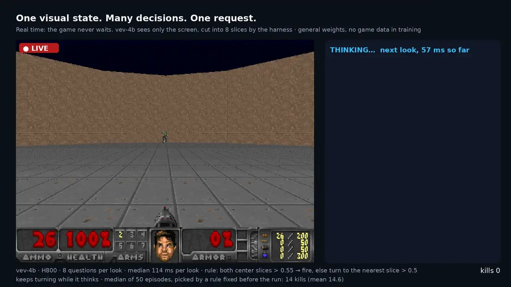

# Vev

[](README.md) [](README_zh.md) [](https://huggingface.co/collections/CountingSheep/vev) [](https://huggingface.co/spaces/CountingSheep/vev)

**兼容 Jev 接口、支持图片输入的决策模型。**



vev-4b 0.1.0 实时玩 Doom。外围程序（harness）每帧把画面切成 8 个竖条，在一次请求里对每个竖条问一个是/否问题（"这一条里有没有怪物？"），再按固定规则把答案转换成转向和开火。游戏不会暂停等待模型。

输入一段文本、一条 JSON 记录或一张截图，以及若干是/否、单选或打分问题，返回每个选项的概率。模型只在给定的选项之间打分，不生成文本。单个带图问题在一张 GPU 上的耗时约 100–120 ms（见[速度](#速度)）。权重公开，可以本地部署。

- **兼容 Jev 接口。** [Jev](https://typesafe.ai/blog/introducing-system-one-models-and-jev) 是 TypeSafe 提供的托管决策模型。Vev 实现了同样的 `/v1/systemone` 请求格式，基于 TypeSafe SDK 的代码只需修改 base URL。
- **支持图片输入。** 截图和照片可以与文本一起放入请求。
- **支持中文和英文。** 基于 Qwen3.5 微调。


```python
# client 和 checkout_png 的创建方式见下文"开始使用"
resp = client.system_one(
    state={"screen": {"image": {"url": checkout_png}}},
    questions={
        "error": Noul(instructions="Does the screen show an error message?"),
        "step": Choice(instructions="Which checkout step is the user on?",
                       criteria={"shipping": None, "payment": None, "review": None}),
        "next": Choice(instructions="What should the user do next?",
                       criteria={"retry": "Try another card", "wait": "Wait for the order to ship",
                                 "nothing": "Nothing, the order went through"}),
    },
)
# vev-4b 0.2.0:  error 0.996
#                step  {"shipping": 0.002, "payment": 0.965, "review": 0.033}
#                next  {"retry": 0.996, "wait": 0.002, "nothing": 0.003}
```

当前版本为 v0.2 研究预览版：`vev-4b` 为 0.2.0，`vev-9b` 仍为 0.1.0。权重采用 CC BY-NC 4.0 许可。在四个文本评测集中，Jev 在其中一个上仍明显优于 Vev（见[文本](#文本)）。

## 开始使用

环境要求：Python 3.11 及以上、NVIDIA GPU、CUDA 版 PyTorch。Windows 上 pip 默认安装 CPU 版 PyTorch，需要先按 [pytorch.org](https://pytorch.org/get-started/locally/) 的说明安装 `torch` 和 `torchvision`。

```bash
pip install git+https://github.com/Xiaooolong/vev
vev serve --model CountingSheep/vev-4b          # 首次启动时下载权重，监听 127.0.0.1:8009
```

首次启动时服务会先预热 GPU kernel，Triton 缓存为空时约需两分钟。

之后可以用 TypeSafe 的 Python SDK 发送请求（`pip install typesafe-sdk`）：

```python
from typesafe_sdk import Choice, Noul, TypeSafeClient

client = TypeSafeClient(api_key="local", base_url="http://127.0.0.1:8009")
resp = client.system_one(
    state="Order #4411 still shows 'label created' after 9 days. I need it before Friday.",
    questions={
        "urgent": Noul(instructions="Is the customer asking for something time-sensitive?"),
        "team": Choice(instructions="Which team should handle this?",
                       criteria={"shipping": "Delivery and tracking", "billing": "Charges and refunds"}),
    },
)
print(resp.answers["urgent"].noul)          # "是"的概率，vev-4b 0.2.0 输出 0.97
print(resp.answers["team"].probabilities)   # {"shipping": 0.97, "billing": 0.03}
```

`Noul` 是该接口中是/否问题的类型名。状态可以是字符串或任意 JSON 对象；图片写成 `{"image": {"url": "data:image/png;base64,..."}}`，可以放在对象中的任意位置：

```python
import base64

checkout_png = "data:image/png;base64," + base64.b64encode(open("docs/checkout.png", "rb").read()).decode()
```

### 其他运行方式

- `--revision v0.1.0` 加载 0.1.0 的权重，`--revision v0.2.0` 加载当前版本。
- Docker：`docker build -t vev .`，然后 `docker run --gpus all -p 8009:8009 -v ~/.cache/huggingface:/root/.cache/huggingface vev --model CountingSheep/vev-4b`。
- Decision Index 测评所用的固定版本环境和启动脚本见 [docs/serving.md](docs/serving.md)（英文）。
- 不启动 HTTP 服务、在代码中直接调用：

  ```python
  from vev.model import CheckpointEngine

  engine = CheckpointEngine("CountingSheep/vev-4b")
  result = engine.run({"ticket": "My kettle never arrived."},
                      {"refund": {"type": "noul", "instructions": "Is the customer asking for a refund?"}})
  print(result.answers["refund"]["noul"])
  ```

- 在其他推理框架中使用：[spec/systemone-api.md](spec/systemone-api.md)（英文）第 10 节给出了 prompt 模板和需要读取的 token 概率；`vev-4b` 0.2.0 的读取方式见[原理](#原理)。

### 速度

在 Decision Index 视觉题库的公开题上，按榜单的计时方式测量（逐个发送请求，每个请求一个问题，端到端计时，包含客户端的图片编码，图片最大 1.6 MP）：

| GPU | 题目 | 中位数 | 平均 | p80 |
|---|---|---|---|---|
| H800 | 全部 12,210 道 | 101 ms | 151 ms | 225 ms |
| RTX PRO 6000 Blackwell | 1,294 道，按整个题库加权 | 120 ms | 182 ms | 283 ms |

同一请求中的所有问题合成一个 batch 计算。一个 `vev serve` 进程一次处理一个请求，需要更高吞吐时可以每张 GPU 启动一个进程。详见 [docs/serving.md](docs/serving.md#latency)（英文）。

## 结果

以下均为完整评测集上的准确率，使用 `evals/` 中的评测工具对 `vev serve` 测得。"显著"指同一批题上配对 bootstrap 的 95% 区间不含 0。完整指标和对比数据在 [results/](results/)。

### Jev Decision Index

[Jev Decision Index](https://huggingface.co/spaces/multimodalart/jev-decision-index) 公开题库上的结果，使用榜单官方的评测工具测得。分数采用榜单的 skill 指标（扣除随机猜测的影响后乘以 100）。榜单总分还包括只有维护者能运行的私有题，因此总分未知。

| 题库 | vev-4b 0.1.0 | vev-4b 0.2.0 |
|---|---|---|
| 视觉，公开题（12,210 道） | – | 72.90 |
| 文字，公开题，edition 0.3 | 38.91 | 60.32 |

0.1.0 未在视觉题库上测试。0.2.0 使用了针对榜单各类任务构建的训练数据，来源为相应数据集的训练集（见 [TRAINING_DATA.md](TRAINING_DATA.md)，英文）。各评测项的分数见 `results/decision-index/` 和 [vev-4b 模型卡](https://huggingface.co/CountingSheep/vev-4b)。

### 文本

| 评测集 | n | Qwen3.5-4B | kev-4B | vev-4b 0.2.0 | Jev |
|---|---|---|---|---|---|
| [judgekit](https://github.com/lexingtonhibiki/judgekit)（中文） | 130 | 0.962 | 0.846 | 0.962 | 0.962 |
| [JevBench](https://github.com/fstandhartinger/jevbench)（公开子集） | 231 | 0.758 | 0.719 | 0.835 | 0.861 |
| [nimble](https://github.com/bespokelabsai/nimble) | 324 | 0.710 | 0.735 | 0.806 | 0.923 |
| [kev](https://github.com/jaredpalmer/kev) transfer-v4（训练中未出现的来源） | 1528 | 0.758 | 0.802 | 0.842 | 0.854 |

Qwen3.5-4B 是未微调的基座模型，按同样方式读取概率。kev-4B 使用同一套评测工具在本地运行。Jev 通过 TypeSafe 的 API 调用（`jev-latest`，2026 年 9 月 23–24 日），训练中没有使用任何 Jev 的输出。

微调后四个评测集中有三个优于基座（judgekit 持平），四个均显著优于 kev-4B。Jev 在 nimble 上比 Vev 高 11.7 个点，其余差距均不显著。

### 图片

公开的视觉评测大多是针对图片内容提问，而 Vev 主要用于按给定规则判断图片，因此另外用人工标注的公开数据构建了判断集。转换脚本在 `evals/datasets/`，转换后的数据不再分发。Jev 的 API 只接受文本输入，因此没有 Jev 的结果。

| 评测集 | 判断内容 | n | Qwen3.5-4B | vev-4b 0.2.0 |
|---|---|---|---|---|
| policy_mod | 图片是否违反给定的安全规则（LlavaGuard） | 659 | 0.686 | **0.760** |
| game_glitch | 游戏截图中是否有画面错误（VideoGameQA-Bench） | 1000 | 0.646 | 0.647 |
| game_clip | 物体是否穿进角色模型（VideoGameQA-Bench） | 686 | 0.561 | **0.810** |
| ui_toggle | 是否有处于打开/关闭状态的开关（MobileViews） | 800 | 0.901 | **0.920** |
| ui_input | 是否有文本输入框（MobileViews） | 800 | 0.949 | 0.950 |
| t2i_elem | 生成图片中是否有提示词里的某个元素（EvalMuse） | 1027 | 0.690 | 0.673 |
| MMBench-EN | 关于照片的通用问题 | 1164 | 0.872 | **0.900** |
| POPE | 照片中是否有某个物体 | 9000 | 0.894 | **0.900** |
| MMStar | 关于照片的通用问题 | 1498 | 0.544 | **0.694** |

加粗表示显著优于基座。

### 与 0.1.0 对比

在 18 个发布评测集上，`vev-4b` 0.2.0 有 8 个显著优于 0.1.0（JevBench、nimble、kev transfer-v4、MMBench-EN、POPE、MMStar、game_clip、game_glitch），4 个显著变差：game_vr −22.0（从 0.940 降到 0.720）、policy_cat −11.2、t2i_elem −4.2、ui_toggle −0.8。全部 18 个评测集的结果见[模型卡](https://huggingface.co/CountingSheep/vev-4b)。

如需在自己的数据上评估 Vev，可以按[记录格式](evals/README.md)准备几百条带标注的样例，对服务运行 `python -m evals.run`。它会输出准确率、校准情况，以及不同覆盖率下置信度最高部分的准确率。

## 局限

- 模型能较好地区分各答案的可能性，但输出的概率不等于实际正确率：各评测集上的期望校准误差为 0.01–0.15（Jev 在文本集上为 0.04–0.07）。如果按阈值做决策，建议用自己的标注数据确定阈值。
- 在四个文本评测集上，将选项顺序倒置后，有 3–11% 的题目答案会改变（Jev 低于 4%）。实际使用时建议固定选项顺序。
- 同一个问题单独提问和与其他问题一起提问，概率可能相差零点零几。同一请求重复发送，结果不变（[spec §6](spec/systemone-api.md#6-semantic-guarantees)）。
- `vev-4b` 0.2.0 在四个自建图片评测集上不如 0.1.0，差距最大的是 game_vr（游戏截图与参考图的对比，−22 个点）。
- 图片判断集由公开数据转换而来，不是公认的评测基准。
- 兼容是指请求和响应格式与 `/v1/systemone` 一致，不代表 Vev 的行为与 Jev 相同。Vev 与 TypeSafe 没有关联，也未获其认可。

## 原理

每个问题会被组织成一段 prompt，包含状态、问题和带字母编号的选项。Vev 读取模型在答案 token（Yes/No、选项字母、档位数字）上的下一 token 概率，并在合法答案之间重新归一化。微调（在 Qwen3.5 上做 LoRA）调整的是这组概率，没有额外的分类头。

`vev-4b` 0.2.0 读取请求的方式与 0.1.0 不同：在 8 个全注意力层中，状态部分的 token 之间使用双向注意力；较短的文本状态会写两遍，顺序为状态、问题说明、再一遍状态、带选项的问题；带图片且只有一个问题的请求，图片也按同样方式放两遍。这些设置来自检查点的 `vev.json`（[详见](docs/serving.md#start)，英文）；没有这些设置的检查点（如 0.1.0）按原方式读取。

| 文档（英文） | 内容 |
|---|---|
| [spec/systemone-api.md](spec/systemone-api.md) | 请求格式、限制、错误码、行为保证、prompt 模板 |
| [TRAINING_DATA.md](TRAINING_DATA.md) | vev-4b 0.2.0 的训练数据来源、删除的数据、与评测数据的重叠 |
| [TRAINING.md](TRAINING.md) | 0.1.0 的训练配方 |
| [evals/](evals/README.md) | 评测集的转换方法，以及对任意 `/v1/systemone` 服务运行评测 |
| [conformance/](conformance/README.md) | 按接口规范检查实现，包括官方接口 |
| [docs/serving.md](docs/serving.md) | 固定版本环境、启动脚本、预热、延迟 |

| 模型 | 基座 | Hugging Face |
|---|---|---|
| `vev-4b` | Qwen3.5-4B | [CountingSheep/vev-4b](https://huggingface.co/CountingSheep/vev-4b)（0.2.0）；adapter [vev-4b-lora](https://huggingface.co/CountingSheep/vev-4b-lora)（仅 0.1.0） |
| `vev-9b` | Qwen3.5-9B | [CountingSheep/vev-9b](https://huggingface.co/CountingSheep/vev-9b)，adapter [vev-9b-lora](https://huggingface.co/CountingSheep/vev-9b-lora)（均为 0.1.0） |

## 许可

代码：Apache 2.0。模型权重：CC BY-NC 4.0。

## 引用

```bibtex
@software{vev2026,
  title  = {Vev: Jev-like decision models that can also see images},
  author = {Wang, Xiaolong},
  year   = {2026},
  url    = {https://github.com/Xiaooolong/vev},
  version = {0.2.0}
}
```
